# 0. Resultado de generación y contrato de uso

```text
RESULT = COMPLETE_WITH_NON_BLOCKING_LIMITATIONS

PRIMARY_TECHNICAL_DOMAIN =
SOKOBAN_JAVA_SWING_OO_DESIGN

OBJECTIVE_CURRENT =
transferir a todo el equipo un estado común, autocontenido y auditable
del Trabajo Integrador Sokoban, incluyendo requisitos, aclaraciones,
decisiones, evidencia, UML, riesgos y próximos pasos.

TECHNICAL_STATE_VERSION =
SOKOBAN_DESIGN_BASELINE_UML_V0.5
+ CORE_STATE_SPIKE_E3
+ MOVEMENT_INTERACTION_SPIKE_E3
+ CLASS9_TRANSCRIPT_RECONCILIATION
+ CLASS10_MATERIAL_RECONCILIATION

CONTINUITY_PACKAGE_REVISION =
TEAM_CAPSULE_SCHEMA9_V4.0

ACTIVE_TASK = NONE

NEXT_ACTION_RECOMMENDED =
revisión grupal + cierre del contrato TXT + spike de Builder para Level

ACTIVE_TASK_AUTHORIZED = false

CONTEXT_SELF_CONTAINED = true

READ_ONLY_CONTINUATION_SELF_CONTAINED = true

EXECUTION_BYTE_SELF_CONTAINED = false

SAFE_FOR_CONTEXT_REHYDRATION = true

SAFE_FOR_READ_ONLY_CONTINUATION = true

SAFE_FOR_MUTATING_EXECUTION = false
```

## 0.1 Qué significa “autocontenido” en esta cápsula

Este archivo está pensado para compañeros que **no poseen**:

- los chats donde se produjo el análisis;
- las transcripciones Whisper;
- los PDFs de cátedra;
- los RAR;
- los ZIP de spikes;
- los archivos PlantUML;
- los resultados de GitHub investigados;
- las cápsulas anteriores.

Por lo tanto, **no se requiere ninguno de esos archivos para comprender el estado actual**.

Cuando este documento menciona una fuente, la mención conserva trazabilidad; no es una instrucción de
“ir a leerla para completar lo que falta”.

Toda conclusión que controle una decisión futura se reproduce aquí con suficiente contexto.

## 0.2 Qué NO contiene

No contiene los bytes ejecutables/completos de:

- los spikes Java;
- el repositorio Git del equipo;
- los assets finales;
- los RAR de código de cátedra.

Por eso:

```text
EXECUTION_BYTE_SELF_CONTAINED = false
```

La cápsula sirve para comprender, discutir, revisar y planificar.  
No debe tomarse como sustituto del repositorio productivo cuando éste exista.

---

# 1. Objective Contract

## 1.1 Objetivo vigente

Construir en equipo una versión de **Sokoban** en:

```text
Java + Swing + GUI 2D
```

que cumpla la consigna oficial y permita justificar con precisión:

```text
SOLID
GRASP
MVC
GoF
```

sin aplicar patrones de forma ceremonial.

## 1.2 Definition of Done del proyecto

El TPO estará realmente terminado cuando:

- todas las mecánicas oficiales funcionen;
- los niveles se carguen desde TXT externo;
- el profesor pueda crear un TXT compatible a partir de nuestra especificación;
- las dos funcionalidades adicionales estén implementadas;
- el core esté separado de Swing;
- el diseño y el código coincidan;
- exista StarUML;
- exista README;
- exista video de gameplay;
- exista informe técnico;
- los assets cumplan la restricción de dominio público;
- el uso de IA esté declarado;
- todos los integrantes puedan defender:
  - requisitos;
  - responsabilidades;
  - clases;
  - interfaces;
  - relaciones;
  - principios;
  - patrones;
  - alternativas;
  - tests;
  - consecuencias.

## 1.3 Objetivo actual de corto plazo

El objetivo técnico prioritario acordado de hecho por el trabajo previo y coherente con la cátedra es:

```text
TXT
→ parseo
→ construcción del Level
→ Board de objetos
```

con un **patrón creacional real y defendible**.

La alternativa actualmente preferida es:

```text
Builder
```

pero aún debe pasar:

```text
TEAM REVIEW
+
CODE SPIKE
+
TXT CONTRACT REVIEW
```

antes de marcarse `ACCEPTED`.

## 1.4 Fuera de alcance inmediato

No es prioridad inmediata:

- pulir gráficos finales;
- crear animaciones;
- diseñar un game loop;
- incorporar Prototype sin necesidad real;
- inventar las dos features adicionales antes de estabilizar el core;
- implementar patrones sólo para “sumar patrones”.

---

# 2. Modelo de autoridad y estados

## 2.1 Jerarquía normativa

Cuando dos fuentes entren en conflicto:

```text
1. Consigna oficial
2. Aclaración directa posterior del profesor
3. Explicación oral del profesor
4. Material oficial de cátedra
5. Decisión explícita del equipo
6. Bibliografía técnica
7. Referencias GitHub
8. Inferencia/análisis
```

## 2.2 Estados utilizados

| Estado | Significado |
|---|---|
| `OFFICIAL` | requerido por la consigna |
| `TEACHER-EXPLICIT` | dicho explícitamente por el profesor |
| `TEACHER-GUIDED` | fuertemente sugerido por el profesor |
| `COURSE` | enseñado formalmente en materiales/clase |
| `TEAM-PROPOSAL` | propuesta surgida en el grupo |
| `PREFERRED` | opción actualmente mejor respaldada |
| `E3-VALIDATED` | probada por spike reproducible |
| `OPEN` | falta decidir o la fuente no alcanza |
| `REJECTED-FOR-NOW` | no se justifica con el problema actual |
| `SUPERSEDED` | reemplazado por evidencia/decisión posterior |
| `HISTORICAL` | útil para historia, no controla el estado actual |

## 2.3 Regla central

```text
NO reemplazar problema por patrón.
NO reemplazar responsabilidad por clase.
NO reemplazar test por UML.
NO reemplazar simplicidad por “flexibilidad futura”.
NO convertir una recomendación en requisito.
NO convertir una hipótesis en decisión del equipo.
```

Cadena de razonamiento:

```text
NECESIDAD
→ ESCENARIO
→ RESPONSABILIDAD
→ COLABORACIÓN
→ VARIACIÓN
→ ALTERNATIVA SIMPLE
→ PATRÓN SI JUSTIFICA SU COSTE
→ UML
→ CÓDIGO
→ TEST
→ EVIDENCIA
→ DEFENSA
```

---

# 3. Consigna oficial — baseline normativa completa

## 3.1 Objetivo

Aplicar principios y patrones de diseño presentados en la materia construyendo una versión de Sokoban.

## 3.2 Tablero obligatorio

Debe contemplar:

- paredes;
- espacios vacíos;
- cajas normales;
- cajas frágiles;
- cajas llave;
- casillas destino;
- terrenos resbaladizos;
- casilleros cerrojo;
- muros abiertos/cerrados;
- jugador Sokoban.

## 3.3 Niveles

Los niveles se cargan desde:

```text
archivos .txt
```

que representan la disposición inicial mediante caracteres.

La consigna **no define** el alfabeto.

Eso es responsabilidad del equipo.

## 3.4 Movimiento

El jugador:

- usa flechas;
- empuja cajas;
- no tira de cajas;
- no empuja más de una caja simultáneamente;
- no atraviesa cajas;
- no atraviesa paredes;
- no atraviesa muros cerrados.

## 3.5 Caja normal

Al intentar moverse hacia una caja normal:

- si el desplazamiento es legal;
- la caja se mueve en la misma dirección.

En terreno resbaladizo la caja se desliza.

Nunca atraviesa:

- cajas;
- paredes;
- muros cerrados.

## 3.6 Caja frágil

Mantiene las reglas de caja normal y además:

- tiene resistencia;
- cada push reduce resistencia;
- resistencia 0 → se rompe.

La consigna no define el valor inicial.

## 3.7 Caja llave

Mantiene las reglas normales.

Si queda sobre un casillero cerrojo:

```text
abre los muros correspondientes
```

La consigna no define:

- cardinalidad Lock↔Wall;
- IDs;
- permanencia;
- re-cierre.

## 3.8 Undo

Regla oficial:

```text
se pueden deshacer los últimos 15 movimientos
cada click de Undo vuelve exactamente 5 movimientos
máximo 3 usos consecutivos
```

No se define:

- qué pasa si hay menos de 5;
- qué reinicia la consecutividad;
- qué pasa con métricas/puntaje;
- qué pasa después de restart.

## 3.9 Victoria

Regla literal:

```text
victoria = todas las cajas están en sus destinos
```

Luego:

```text
avanzar al siguiente nivel
```

Existe una ambigüedad con `KeyBox` si debe permanecer sobre `LockTile`.

## 3.10 Puntaje

Al finalizar un nivel mostrar:

- movimientos;
- empujes;
- uso de Undo;
- puntaje final.

La fórmula es responsabilidad del equipo.

## 3.11 HUD

Mostrar:

- movimientos;
- empujes;
- nivel actual.

Botones visibles:

- Undo;
- Restart.

## 3.12 Gráficos y sonidos

- todos los elementos del tablero deben tener representación gráfica;
- las acciones deben tener efectos de sonido;
- los assets deben ser **de dominio público**.

## 3.13 Dos funcionalidades adicionales

Son obligatorias:

```text
2 funcionalidades nuevas
```

Cada una debe implicar aplicación de patrones.

## 3.14 Tecnología

```text
Java
Swing
2D
```

## 3.15 Entregables

- repositorio público GitHub;
- README de ejecución;
- video gameplay;
- diagrama de clases StarUML;
- informe técnico con decisiones y justificación.

Entrega por correo institucional al profesor:

```text
jpepe@uade.edu.ar
```

Un integrante envía, con los demás en copia, incluyendo:

- nombre del equipo;
- apellido/nombre de integrantes.

## 3.16 Evaluación

Principalmente:

```text
SOLID
GRASP
MVC
GoF
```

Además:

- creatividad;
- código;
- documentación;
- diseño.

La defensa individual oral/escrita determina la nota final.

## 3.17 IA

Puede usarse como apoyo.

Debe declararse.

El equipo debe:

- comprender;
- validar;
- adaptar;
- defender;

todo lo entregado.

---

# 4. Aclaraciones docentes acumuladas sobre Sokoban

Esta sección contiene el contenido relevante ya extraído de las clases.  
No hace falta acceder a ninguna transcripción para utilizarla.

## 4.1 Sokoban no necesita un game loop

El profesor remarcó dos veces que Sokoban fue elegido porque no requiere dinámica típica de videojuegos:

```text
sin FPS
sin trayectoria continua de proyectiles
sin actualización permanente
si el jugador no hace nada, el estado no cambia
```

Consecuencia:

```text
Swing event
→ Controller
→ Model
→ nueva transición
→ View
```

No:

```text
while (running) {
    update();
    render();
}
```

salvo que aparezca un requisito real que lo justifique.

## 4.2 El profesor probará nuestro TXT

El profesor fue especialmente explícito:

- preguntará qué carácter usamos para cada elemento;
- respetará nuestra especificación;
- puede tomar un TXT nuestro;
- reemplazar manualmente, por ejemplo, una pared por una caja;
- ejecutar el juego;
- verificar que el tablero cambia.

Objetivo pedagógico:

```text
demostrar que el nivel se construye leyendo el TXT
y NO está hardcodeado.
```

Por tanto:

```text
TXT_FORMAT = PUBLIC CONTRACT
```

para el proyecto.

## 4.3 Creación de Level debe involucrar un patrón creacional

La nueva transcripción de Clase 9 cambia el grado de certeza.

El profesor indicó que, por el momento, la gran creación del software es:

```text
crear el nivel
```

y dijo que **no aplicar un patrón creacional** para esa creación sería una señal negativa.

Mencionó como posibilidades:

- Abstract Factory;
- Factory Method;
- Builder.

No dijo que deban aplicarse los tres.

Regla del docente:

```text
usar los patrones necesarios,
NO todos los patrones.
```

## 4.4 Builder fue sugerido directamente para Sokoban

Durante la explicación de Builder, el profesor dio explícitamente Sokoban como ejemplo.

La idea expuesta fue:

```text
leer archivo paso a paso
→ ir construyendo el tablero
→ finalmente producir el Level/Board
```

También planteó que el Director puede ser opcional y que podría existir:

- un director para un nivel fácil;
- uno intermedio;
- uno difícil;
- o una construcción guiada por lectura de un archivo.

La conclusión relevante NO es que debamos copiar exactamente ese UML.

La conclusión es:

> Builder es una aplicación directamente reconocida por el docente como válida para la construcción
> del Level.

## 4.5 Builder no se copia “a rajatabla”

La clase fue muy clara:

```text
un patrón es una idea/solución adaptable,
no un algoritmo para copiar y pegar.
```

El Director:

```text
es opcional.
```

El Builder puede variar respecto del diagrama canónico si se conserva la intención.

Esto permite, por ejemplo, que:

```text
LevelParser
```

actúe como Director durante la lectura del TXT sin necesidad de inventar otra clase si no aporta valor.

## 4.6 Prototype: explícitamente NO necesario para este TPO

La aclaración es ahora fuerte.

El profesor explicó:

```text
Prototype tiene sentido si la creación es costosa
o si necesitamos muchas copias casi idénticas.
```

Y para Sokoban señaló que:

```text
no hace falta necesariamente implementar Prototype;
el tablero va a cargar rápido.
```

Regla:

```text
si no existe el problema,
no aplicar la solución.
```

Esto convierte Prototype para la carga normal de Level en:

```text
REJECTED-FOR-NOW
```

y no simplemente “pendiente”.

## 4.7 Hielo

Del ejemplo visual anterior:

- la caja entra a hielo;
- continúa en la dirección del push;
- atraviesa la franja;
- termina en el primer espacio normal vacío posterior;
- el jugador no se desliza.

Sigue abierto:

```text
¿qué sucede exactamente si al final de la franja hay un obstáculo?
```

## 4.8 Caja frágil

La explicación docente reforzó:

- cada push reduce resistencia;
- puede romperse;
- una caja rota puede hacer irresoluble el nivel;
- los niveles deben diseñarse con resistencia razonable.

Sigue abierto:

```text
fragile + hielo + resistencia que llega a cero
```

porque no está especificado:

- cuándo se considera consumido el push;
- dónde desaparece la caja;
- si completa el sliding antes de romperse.

## 4.9 Observer para Lock→Walls

El profesor anticipó explícitamente Observer al explicar:

```text
¿cómo se entera el muro de que la caja llave llegó al cerrojo?
```

Mapeo candidato:

```text
LockTile = Subject
OpenableWall = Observer
```

## 4.10 Memento para Undo

El profesor describió el problema como:

```text
guardar estados del tablero en el tiempo
para recuperar estados anteriores
```

Esto alinea directamente el caso con Memento.

## 4.11 Strategy para score

El puntaje fue descrito oralmente como:

```text
estrategia / política de cálculo
```

Por eso `ScoreStrategy` es una solución natural.

## 4.12 HUD sin tiempo

El juego de referencia podía mostrar tiempo, pero:

```text
el tiempo NO es requisito del TPO.
```

## 4.13 Animaciones

No son obligatorias.

## 4.14 IA

En Clase 9 el profesor reforzó:

```text
la IA está para ayudar,
no para pensar por el equipo.
```

La decisión final sobre qué se mergea:

```text
es humana.
```

Además aconsejó no aceptar la primera solución automáticamente.

Para la parte visual fue mucho más permisivo porque no es el foco de evaluación.

## 4.15 Diseño antes de código

Durante la corrección del parcial el profesor explicó que UML:

- es una herramienta de comunicación;
- debe especificar lo importante con precisión;
- se utiliza para discutir el diseño;
- luego de que el equipo coincide en el diseño, se implementa.

Mensaje operativo:

```text
primero planos
después ladrillos
```

Esto refuerza que nuestro trabajo de UML previo al código productivo no es burocracia: es parte del enfoque esperado.

---

# 5. Recomendación docente sobre assets

El profesor compartió/recomendó fuentes de assets y sonidos.

El usuario del proyecto confirmó específicamente:

```text
Pixabay
https://pixabay.com/

Kenney
https://kenney.nl/
```

Estado:

```text
TEACHER-RECOMMENDED-SOURCES
```

Pero la consigna oficial sigue diciendo:

```text
TODOS los assets deben ser de dominio público.
```

Por lo tanto:

```text
sitio recomendado ≠ licencia automáticamente válida
```

Política del equipo:

1. preferir assets que indiquen inequívocamente:
   - public domain;
   - CC0;
2. guardar evidencia de la licencia de cada asset;
3. registrar:
   - nombre;
   - autor/origen;
   - URL;
   - licencia;
   - fecha de consulta;
4. si la licencia es ambigua:
   - no usar el asset;
   - o consultar al profesor.

Kenney es una fuente prioritaria para revisar por su orientación explícita a assets de juegos.

Pixabay puede utilizarse como fuente de búsqueda, pero cada recurso seleccionado debe superar la verificación de licencia del proyecto.

---

# 6. Clase 8 — reglas pedagógicas de patrones

## 6.1 Patrón ≠ código para copiar

El profesor presentó un patrón como:

```text
problema recurrente
+
solución estructurada
+
consecuencias
```

## 6.2 UML

Los patrones se comunican principalmente mediante UML.

Por eso el StarUML debe mostrar:

- participantes;
- relaciones;
- responsabilidades;
- interfaces;
- dependencias.

No basta con escribir el nombre:

```text
<<Observer>>
```

si la colaboración real no corresponde a Observer.

## 6.3 Patrones anunciados

Creacionales:

- Singleton
- Factory Method
- Abstract Factory
- Builder
- Prototype

Estructurales:

- Adapter
- Bridge
- Composite
- Decorator
- Facade

Comportamiento:

- Command
- Mediator
- Memento
- Observer
- State
- Strategy
- Template Method

## 6.4 Factory Method

No es:

```text
cualquier clase llamada Factory
```

Estructura conceptual:

```text
Product
ConcreteProduct

Creator
ConcreteCreator
```

Coste:

```text
jerarquía Creator/Product crece en paralelo
```

## 6.5 Abstract Factory

Sirve para:

```text
familias coherentes de productos relacionados
```

No tiene sentido si no existen familias.

## 6.6 Polimorfismo

La cátedra insiste en evitar:

```text
getClass()
instanceof distribuido
switch por tipo
```

cuando el comportamiento pertenece al tipo.

No significa eliminar condicionales de estado.

Ejemplos correctos:

```java
if (cell.isBlocked()) { ... }
if (history.size() >= 5) { ... }
```

Señal de diseño a revisar:

```java
if (box instanceof FragileBox) { ... }
```

cuando `FragileBox` podría responder polimórficamente.

---

# 7. Clase 9 — Builder, Prototype, Git, GitHub y reglas de diseño

## 7.1 Builder

Problemas explicados:

- constructores gigantes;
- demasiados parámetros;
- `null` para opcionales;
- setters indiscriminados;
- dificultad para mantener inmutabilidad;
- proceso de creación complejo.

Participantes:

```text
Product
Builder
ConcreteBuilder
Director (opcional)
Client
```

## 7.2 Director

Punto importante:

```text
Director NO es obligatorio.
```

Puede contener secuencias estándar de construcción.

Si el cliente puede coordinar los pasos claramente, puede omitirse.

## 7.3 Aplicación directa a Sokoban

El profesor dijo explícitamente que un Level puede construirse:

```text
paso a paso mientras se lee el archivo
```

y mencionó Builder como posibilidad concreta.

## 7.4 Prototype

Sirve para:

- creación costosa;
- gran volumen;
- muchas copias similares;
- clonación desde un prototipo.

No está justificado para la carga normal de nuestro Sokoban.

## 7.5 Combinación de patrones

La clase mostró que los patrones pueden combinarse cuando existen razones.

Ejemplo de cátedra:

```text
Prototype Registry + Singleton
```

La regla sigue siendo:

```text
combinación por necesidad,
no por colección de nombres.
```

## 7.6 Git/GitHub

Flujo enseñado:

```text
repo
→ branch
→ commits
→ push
→ pull request
→ revisión
→ tests
→ merge
→ release
```

El profesor remarcó:

- otra persona debe revisar el PR;
- no “me apruebo mi propio PR”;
- revisar tests antes del merge;
- README debe explicar cómo levantar el proyecto.

## 7.7 Prioridad del TPO indicada en Clase 9

El profesor dijo que, en ese momento de la cursada, lo principal que podían adelantar era:

```text
cómo crear el nivel
```

porque todavía faltaban patrones estructurales y de comportamiento.

Esto coincidió con la prioridad adoptada en el grupo.

---

# 8. Corrección del parcial — reglas de diseño que afectan directamente al TPO

Esta parte de la clase no era Sokoban, pero revela con mucha precisión cómo evalúa el profesor el diseño.

## 8.1 LSP

Ejemplo:

```text
Tropa.atacar()
Monje extiende Tropa
Monje lanza excepción porque no puede atacar
```

Diagnóstico:

```text
violación de Liskov
```

Consecuencia para Sokoban:

> no crear jerarquías donde una subclase tenga que “romper” operaciones heredadas.

Esto importa para `Box` y futuras features.

## 8.2 Information Expert

Ejemplo del examen:

`CalculadorRiesgo` consultaba repetidamente datos que pertenecían a `Poliza`.

Diagnóstico:

```text
Feature Envy
+
Information Expert mal asignado
+
más acoplamiento
```

Refactor:

mover la responsabilidad hacia quien posee la información cuando tenga sentido.

Consecuencia para Sokoban:

- `Board` debe conocer estructura espacial;
- `RestorableLevelState` debe ser fuente del estado mutable;
- no duplicar estado del tablero en Controller/View;
- una regla debe vivir donde están sus datos o en un Domain Service cuando requiere varias fuentes.

## 8.3 MVC

Pregunta del parcial:

```text
¿dónde validar una regla de negocio?
```

Respuesta docente:

```text
MODEL
```

No:

- View;
- Controller;
- DTO.

Consecuencia:

```text
Swing NO decide movimiento,
victoria,
resistencia,
score,
gate state.
```

## 8.4 Abstraer lo que varía

En el ejercicio de pagos, el error frecuente fue convertir `ProcesadorPago` en interfaz.

El profesor explicó que:

```text
ProcesadorPago = servicio concreto
MedioPago = abstracción variable
Tarjeta/Transferencia/Billetera = implementaciones
```

y el servicio recibe/injecta un `MedioPago`.

Lección para Sokoban:

> no convertir cada clase en interfaz “por DIP”.

Debemos abstraer:

```text
lo que realmente varía
```

No crear interfaces ceremoniales.

## 8.5 UML debe comunicar firmas completas

El profesor criticó métodos UML del estilo:

```text
calcularPrecio(...)
```

sin aclarar parámetros/retorno.

Regla:

si una operación se muestra porque importa, especificar:

```text
nombre(parámetros : Tipo) : TipoRetorno
```

Esto debe aplicarse al StarUML final.

## 8.6 Fuente única del estado

En la revisión de reservas, el profesor rechazó duplicar las mismas reservas en múltiples clases porque genera:

- redundancia;
- inconsistencias;
- mayor mantenimiento.

Aplicación Sokoban:

```text
GameSession / RestorableLevelState
```

deben ser fuente canónica.

View/Controller no deben almacenar copias divergentes del board.

---

# 9. Clase 10 — nuevos patrones estructurales disponibles

El material nuevo incorpora formalmente:

```text
Adapter
Decorator
```

y manda:

```text
avanzar con el modelado e implementación del TI
```

## 9.1 Adapter

Problema:

```text
interfaces incompatibles
```

Participantes:

```text
Target
Adaptee
Adapter
Client
```

El Adapter:

- implementa la interfaz esperada;
- contiene al adaptado;
- traduce llamadas/datos;
- evita modificar cliente y clase legada.

### Estado para Sokoban

```text
NOT_JUSTIFIED_BASELINE
```

No tenemos actualmente:

```text
interfaz externa/legada incompatible
```

que deba integrarse.

Podría aparecer si:

- usamos una librería externa de audio;
- integramos una API con interfaz incompatible;
- importamos un formato de nivel legado.

Hasta entonces:

```text
NO Adapter por decoración.
```

## 9.2 Decorator

Problema:

```text
agregar responsabilidades/combinaciones
sin explosión de subclases
```

Estructura:

```text
Component
ConcreteComponent
BaseDecorator
ConcreteDecorator
```

Usa composición/envoltura.

### Estado para Sokoban

```text
CANDIDATE_FOR_FUTURE_FEATURES
NOT_REQUIRED_BASELINE
```

Podría ser útil si una feature adicional introduce combinaciones dinámicas:

```text
Box
+ Power A
+ Power B
+ Power C
```

donde crear subclases para cada combinación sería una explosión.

Pero para las tres cajas oficiales actuales:

```text
Normal / Fragile / Key
```

todavía no está demostrado que Decorator sea mejor que polimorfismo simple.

## 9.3 Código de cátedra disponible en Clase 10

El archive de Clase 10 contiene ejemplos con estas clases/nombres:

### Adapter

```text
ILoggerEstructurado
SistemaLogAntiguo
LogAdapterAntiguo
LogroAlcanzado
Juego
```

### Decorator

```text
Arma
PistolaSimple
DecoradorArma
Mira
CargadorExtendido
Silenciador
Juego
```

También contiene un pequeño ejemplo GUI de estudiantes.

Durante la construcción de esta cápsula se pudo inventariar el RAR, pero no se hizo una auditoría completa línea por línea de todos sus `.java`.

Esto es:

```text
NON_BLOCKING_LIMITATION
```

porque la teoría estructural necesaria está reproducida aquí.

---

# 10. Práctica “Resort de lujo” — qué revela sobre el estilo de ejercicios de cátedra

El nuevo ejercicio integrador de cátedra describe varios problemas independientes.

El mapeo siguiente es análisis técnico, no una consigna de Sokoban:

| Problema del Resort | Patrón natural |
|---|---|
| reserva individual/departamento/empresa consultados uniformemente | Composite |
| política de precio por temporada intercambiable | Strategy |
| paquete turístico configurado paso a paso | Builder |
| habitación Disponible/Ocupada/Limpieza | State |
| TermostatoLegacy incompatible | Adapter |
| Checkout Express orquesta subsistemas | Facade |
| cambio de habitación notifica monitores | Observer |
| sistemas únicos de recepción/mantenimiento | Singleton |

Lección útil:

```text
el profesor presenta el PROBLEMA
y espera reconocer el patrón por sus fuerzas,
no por palabras mágicas.
```

Esto es exactamente el criterio que debemos aplicar en Sokoban.

---

# 11. Estado arquitectónico actual

## 11.1 Arquitectura principal

```text
Swing View
    ↓
GameController
    ↓
GameSession
    ↓
Domain
```

Infraestructura lateral:

```text
LevelLoader / Parser / Builder
Audio
Sprites
LevelCatalog
```

## 11.2 Regla MVC

```text
View = presentación
Controller = coordina eventos del sistema
Model = reglas y estado
```

## 11.3 Event-driven

```text
KeyEvent/Button
→ GameController
→ GameSession
→ transición
→ MoveResult
→ View
```

## 11.4 Core independiente de Swing

Objetivo:

```text
tests del dominio sin JFrame/JPanel
```

Esto ya fue demostrado en los spikes.

---

# 12. Representación del tablero

Estado:

```text
PREFERRED
```

Modelo candidato:

```text
Cell
 ├─ Terrain
 └─ Occupant [0..1]
```

## 12.1 Terrain

- Floor
- Wall
- Goal
- Ice
- LockTile
- OpenableWall

## 12.2 Occupant

- Player
- Box
  - NormalBox
  - FragileBox
  - KeyBox

## 12.3 Ventaja

Evita combinaciones artificiales:

```text
BoxOnGoal
BoxOnIce
PlayerOnGoal
KeyBoxOnLock
...
```

El estado de la celda se obtiene por composición.

---

# 13. Variación de Box

Estado:

```text
POLYMORPHISM = PREFERRED
HERENCIA_VS_COMPOSICION = OPEN
```

Modelo explorado:

```text
Box
 ├─ NormalBox
 ├─ FragileBox
 └─ KeyBox
```

Contrato conceptual:

```text
afterPush()
canActivateLock()
```

`FragileBox` maneja su resistencia.

`KeyBox` responde que puede activar `LockTile`.

## 13.1 Regla LSP

No agregar operaciones al tipo base que no tengan sentido para todas las cajas.

Por ejemplo, se eliminó del modelo la idea:

```text
Box.isBroken()
```

como operación común.

`isBroken()` sólo tenía sentido para Fragile.

En el UML refinado, `afterPush()` devuelve un resultado polimórfico:

```text
OK
BROKEN
```

sin obligar a preguntar el tipo concreto.

---

# 14. MovementEngine

Candidato:

```text
MovementEngine <<Domain Service>>
```

Responsabilidad:

```text
coordinar una transición atómica de movimiento
usando información del estado/tablero.
```

No debe poseer una segunda copia del tablero.

Entrada:

```text
RestorableLevelState
Direction
```

Salida:

```text
MoveResult
```

Estados explorados:

```text
MOVED
PUSHED
BOX_BROKEN
BLOCKED
RULE_UNRESOLVED
```

La UI no debe deducir qué pasó inspeccionando el board.

---

# 15. Construcción de Level — decisión actualizada por Clase 9

## 15.1 Estado

```text
Builder =
PREFERRED
+
TEACHER-EXPLICIT-CANDIDATE
+
PENDING_TEAM_RATIFICATION
+
PENDING_CODE_SPIKE
```

## 15.2 Problema

`LevelParser` podría terminar mezclando:

- lectura de caracteres;
- validación;
- ensamblado;
- creación de objetos;
- metadata;
- grupos Lock↔Wall;
- resistencia;
- board final.

Eso amenaza cohesión.

## 15.3 Diseño candidato

```text
LevelLoader
    ↓
LevelRepository
    ↓
LevelParser <<Director candidate>>
    ↓
LevelBuilder
    ↑
SokobanLevelBuilder
    ↓
Level
```

## 15.4 Responsabilidades

`LevelParser`:

```text
interpretar sintaxis
decidir qué paso de construcción corresponde
```

`LevelBuilder`:

```text
contrato de pasos
```

`SokobanLevelBuilder`:

```text
ensamblar producto
validar invariantes de construcción
producir Level
```

`Level`:

```text
producto final
```

## 15.5 Factory Method

Estado:

```text
REJECTED-FOR-NOW como mecanismo principal
```

No aparece naturalmente:

```text
Creator hierarchy
```

## 15.6 Abstract Factory

Estado:

```text
REJECTED-FOR-NOW para loader
```

No existen actualmente familias completas de productos intercambiables en la creación del Level.

## 15.7 Prototype

Estado:

```text
REJECTED-FOR-NOW
```

Ahora respaldado explícitamente por el profesor:

```text
si no hay problema de creación costosa,
no usar Prototype.
```

## 15.8 Simple Factory

Puede existir como helper:

```text
token → instancia
```

pero:

```text
NO llamarla Factory Method GoF
```

si no tiene la estructura GoF.

---

# 16. Formato TXT

Estado:

```text
OPEN / TEAM-DECISION
```

Requisitos mínimos:

- humano;
- documentado;
- fácil de modificar;
- parseable;
- validable;
- permite todos los elementos oficiales;
- un profesor puede escribir un nivel sin leer el código.

## 16.1 Spike previo

Se probó una propuesta de dos capas:

```text
[TERRAIN]
#######
#..R..#
#.L..M#
#..G..#
#######

[OCCUPANTS]
.......
.S.C...
....F..
..K....
.......
```

más metadata.

Eso demostró viabilidad.

NO significa:

```text
FORMAT_ACCEPTED
```

## 16.2 Preguntas abiertas

- una capa o dos;
- símbolos;
- dimensiones;
- comments;
- resistencia de Fragile;
- IDs de Lock/Wall;
- metadata;
- errors;
- charset.

## 16.3 Gate

El contrato se considera bueno cuando otro integrante pueda:

```text
leer sólo la especificación
→ escribir un TXT
→ ejecutar
→ ver exactamente ese nivel
```

---

# 17. Undo / Memento — estado actual y discusión del equipo

## 17.1 Patrón

```text
Memento = PREFERRED + E3-VALIDATED + TEACHER-GUIDED
```

Roles:

```text
GameSession = Originator
GameMemento = Memento
UndoManager = Caretaker
```

## 17.2 Frontera

El Caretaker almacena:

```text
GameMemento
```

No debe conocer/modificar directamente:

```text
RestorableLevelState
```

## 17.3 Historial

```text
MAX_HISTORY = 15
STEPS_PER_UNDO = 5
```

## 17.4 Estado restorable candidato

- tablero;
- posiciones;
- resistencias;
- muros;
- moveCount;
- pushCount.

## 17.5 Métricas de sesión fuera del Memento

Candidato:

```text
SessionMetrics
- undoUsesTotal
- consecutiveUndoUses
```

## 17.6 Discusión real del equipo — 30/09

Se discutió:

> Al hacer Undo, si todas las métricas vuelven atrás, los errores dejan de afectar el puntaje.

Se propuso:

> mantener una estadística separada de cantidad de Undo usados y hacer que afecte el puntaje final.

También se acordó como prioridad de trabajo:

> centrarse primero en cómo generar el nivel a partir del TXT.

### Interpretación de diseño

La mejor separación actual es:

```text
Restorable timeline metrics:
- moves
- pushes

Non-restorable session metrics:
- undoUsesTotal
- consecutiveUndoUses
```

Así:

```text
Undo
→ vuelve el mundo a N-5
→ moveCount/pushCount vuelven con ese estado
→ undoUsesTotal NO vuelve atrás
```

y el score puede penalizar el uso de Undo.

Estado:

```text
TEAM-PROPOSAL
+
ARCHITECTURALLY_PREFERRED
+
PENDING_FORMAL_TEAM_RATIFICATION
```

No está definida todavía la fórmula.

## 17.7 Consecuencia

`LevelStats` para score debería poder obtener:

```text
moves
pushes
undoUses
```

combinando:

```text
RestorableLevelState
+
SessionMetrics
```

Esto evita que el propio Memento borre la evidencia de que se usó Undo.

---

# 18. Strategy / score

Estado:

```text
ScoreStrategy = PREFERRED
FORMULA = OPEN
```

Contrato:

```java
interface ScoreStrategy {
    int calculate(LevelStats stats);
}
```

Variables mínimas candidatas:

- moves;
- pushes;
- undoUses.

## 18.1 Reglas deseables

La fórmula debería ser:

- determinista;
- fácil de explicar;
- fácil de testear;
- evitar negativos absurdos;
- recompensar eficiencia;
- penalizar Undo de forma explícita si el equipo ratifica esa propuesta.

No crear múltiples strategies ficticias sólo para justificar el patrón.

---

# 19. Observer / Lock / Walls

Estado:

```text
Observer =
PREFERRED
+
E3-VALIDATED
+
TEACHER-EXPLICIT
```

Candidato:

```text
LockTile <<Subject>>
    ↓ notify
LockObserver
    ↑
OpenableWall <<ConcreteObserver>>
```

`LockTile` puede preguntar:

```text
box.canActivateLock()
```

sin:

```text
instanceof KeyBox
```

## OPEN

- relación 1:1 / 1:N;
- IDs;
- permanencia;
- cierre;
- múltiples locks;
- interacción con victoria.

---

# 20. Audio / Singleton

El profesor enseñó Singleton con un gestor de sonido.

Candidato:

```text
SoundManager <<Singleton?>>
```

Pero:

```text
GameController → AudioService
AudioService <|.. SoundManager
```

Motivo:

- DIP;
- testabilidad;
- dependencia explícita;
- evitar que el dominio invoque globales.

Estado:

```text
PROPOSED
```

No está decidido que Singleton sea imprescindible.

---

# 21. Patrones estructurales — estado para Sokoban después de Clase 10

| Patrón | Estado actual | Motivo |
|---|---|---|
| Adapter | `NOT_JUSTIFIED_BASELINE` | no existe interfaz incompatible concreta |
| Decorator | `CANDIDATE_FOR_EXTRA_FEATURE` | puede servir para poderes/combinaciones |
| Composite | `AVAILABLE_NOT_SELECTED` | no existe jerarquía parte-todo requerida en baseline |
| Facade | `AVAILABLE_NOT_SELECTED` | no existe subsistema complejo para simplificar todavía |
| Bridge | `AVAILABLE_NOT_SELECTED` | no hay dos ejes independientes de variación demostrados |

Regla:

```text
nuevo patrón estructural
→ sólo si aparece su problema.
```

---

# 22. Dos funcionalidades adicionales

Estado:

```text
OPEN
```

Candidatos discutidos:

- nueva caja;
- dos Sokoban;
- poderes;
- destrucción voluntaria;
- replay;
- logros;
- temas visuales/sonoros.

## 22.1 Decorator como opción futura

Si se diseñan poderes combinables:

```text
BaseBox
→ Speed/Teleport/Shield/...
```

Decorator podría ser mejor que:

```text
BoxConA
BoxConB
BoxConAB
BoxConABC
...
```

Pero esto debe surgir de la feature, no al revés.

## 22.2 Abstract Factory para themes

Podría ser técnicamente válido si tenemos familias:

```text
ClassicTheme:
PlayerSprite
BoxSprite
WallSprite
Sounds

AlternativeTheme:
...
```

Pero una feature puramente cosmética parece menos fuerte que una mecánica jugable.

---

# 23. Victoria — ambigüedad prioritaria

Oficial:

```text
todas las cajas en destinos
```

También oficial:

```text
KeyBox en Lock → abre walls
```

Preguntas:

1. ¿Lock cuenta como Goal para KeyBox?
2. ¿KeyBox activa y luego debe terminar en Goal?
3. ¿Gate queda abierto al retirar KeyBox?
4. ¿KeyBox cuenta entre “todas las cajas”?

Estado:

```text
OPEN
PRIORITY = VERY_HIGH
```

No modificar la regla oficial por conveniencia.

---

# 24. Hielo — ambigüedad prioritaria

Caso aclarado:

```text
Box entra a hielo
→ atraviesa franja
→ sale a primera celda normal libre
```

Caso no aclarado:

```text
hielo → obstáculo inmediato al final
```

Spike actual:

```text
RULE_UNRESOLVED
sin mutar estado
```

Eso es fail-close, no definición oficial.

---

# 25. Fragile + hielo

OPEN:

```text
si resistance llega a 0 en el push que entra a hielo:
¿rompe antes de deslizar?
¿rompe durante?
¿rompe al final?
¿en qué celda desaparece?
```

Debe resolverse antes de congelar interacción final.

---

# 26. Progresión de niveles

Requisito:

```text
victoria → siguiente nivel
```

Contrato candidato:

```java
interface LevelCatalog {
    Optional<String> nextAfter(String levelId);
}
```

Flujo:

```text
isWon()
→ finishLevel()
→ summary
→ nextAfter()
→ load()
→ start()
```

Estado:

```text
PREFERRED
```

Pero la interfaz debe auditarse contra la regla de cátedra:

```text
no crear interfaz ceremonial si no existe variación real.
```

Si el catálogo sólo tiene una implementación estable y no aporta frontera/testabilidad útil, puede simplificarse.

---

# 27. Auditoría de interfaces — regla nueva importante

Después de la corrección del parcial, todas estas interfaces deben justificarse:

```text
GameView
GameActions
AudioService
ScoreStrategy
LockObserver
LevelRepository
LevelCatalog
LevelBuilder
SpriteProvider
```

No todas tienen el mismo grado de necesidad.

## 27.1 Claramente justificadas

```text
ScoreStrategy
LockObserver
LevelBuilder
```

porque modelan variación/rol real.

## 27.2 Justificables por boundary/testabilidad

```text
GameView
AudioService
LevelRepository
SpriteProvider
```

pero deben defenderse por frontera concreta y no “porque DIP”.

## 27.3 Revisar

```text
GameActions
LevelCatalog
```

pueden ser útiles, pero no deben sobrevivir si sólo agregan indirección sin valor.

---

# 28. Evidencia experimental E3

## 28.1 Spike 1 — State / Parser / Memento

Resultado:

```text
PASS 8/8
```

Checks:

```text
PASS parse valid external fixture
PASS reject multiple players
PASS reject fragile without resistance metadata
PASS memento history bounded to 15
PASS undoFive restores exactly five movements
PASS snapshot restores fragile/gate/counters
PASS session undo metric is not part of memento
PASS captured state immutable against source-map mutation
```

Además:

```text
javac -Xlint:all = PASS
```

### Demuestra

- parser externo viable;
- snapshots viables;
- historial 15 viable;
- restauración N-5 viable;
- separar undo metric del snapshot es viable.

### NO demuestra

- formato TXT final;
- score final;
- semántica completa del undo;
- GUI.

## 28.2 Spike 2 — Movement / interactions

Resultado:

```text
PASS 12/12
```

Checks:

```text
PASS free player move
PASS wall blocks without mutation
PASS normal box push
PASS cannot push two boxes
PASS slide across ice to first normal empty
PASS blocked ice exit fails closed
PASS fragile loses one resistance per push while sliding
PASS fragile breaks at zero
PASS key on lock opens two gates via Observer
PASS normal box on lock does not activate
PASS closed gate blocks
PASS opened gate becomes traversable
```

Además:

```text
javac -Xlint:all = PASS
```

### Demuestra

- core independiente de Swing;
- interacción polimórfica viable;
- Observer viable;
- estado especial reversible viable.

### NO demuestra

- que las reglas provisionales sean las definitivas.

---

# 29. Investigación GitHub — lecciones incorporadas

Se estudiaron implementaciones Sokoban para evitar diseñar en vacío.

## qnicondavid/sokobani

Útil para:

- core independiente;
- GameState;
- movement rules;
- MoveResult;
- GameSession;
- eventos;
- tests;
- parser.

Undo:

```text
MoveRecord / operación inversa
```

Lección:

Memento no es la única forma viable.

## mciccale/sokoban

Útil para:

```text
Java + Swing + MVC
```

También muestra undo distribuido.

Problemas observados:

- controller con muchas responsabilidades;
- `instanceof`;
- estado muy compartido.

Lección:

referencia tecnológica, no diseño a copiar.

## nuno-faria/sokoban-game

Útil para:

- snapshots;
- gates;
- mechanics;
- undo.

Lección:

mecánicas especiales hacen atractivo Memento.

## ZhengtianChu/Sokoban

Útil como comparación de:

- MVC;
- Factory;
- Adapter;
- Singleton;
- testing.

## janbodnar/Java-Sokoban-Game

Útil para:

- Swing;
- input;
- sprites;
- render.

No para arquitectura completa.

## Regla

```text
GitHub = bibliografía viva
GitHub ≠ consigna
GitHub ≠ autorización para copiar
```

---

# 30. UML — estado canónico

Evolución:

```text
v0.2
→ auditoría v0.3
→ validación por secuencias v0.4
→ Builder integrado como candidato v0.5
```

## 30.1 Hallazgos de la auditoría

Se corrigió:

- Caretaker recibiendo estado crudo;
- HUD con contrato incorrecto;
- Controller acoplado a SoundManager;
- `Box.isBroken()` en clase base;
- falta de progresión de niveles;
- packages organizados por nombre de patrón.

## 30.2 Hallazgos de secuencias

Se agregó/necesitó:

- `GameSession.start(Level)`;
- `currentState()`;
- `currentLevelId()`;
- `UndoManager.clear()`;
- `Board.removeOccupant()`;
- `BoxPushOutcome`;
- `LevelCatalog`.

## 30.3 Estado de v0.5

Incluye Builder:

```text
LevelParser <<Director>>
→ LevelBuilder
→ SokobanLevelBuilder
→ Level
```

Ahora la transcripción de Clase 9 da soporte docente directo a esta dirección.

---

# 31. PlantUML autocontenido — UML candidato v0.5

El siguiente source está embebido para que cualquier integrante pueda renderizarlo sin recibir otro archivo.

```plantuml
@startuml
skinparam classAttributeIconSize 0
skinparam packageStyle rectangle
skinparam linetype ortho
skinparam nodesep 35
skinparam ranksep 45
hide empty members

title Sokoban — UML integral v0.5 (candidato post Clase 9: Builder, 2026-09-30)

package "presentation (Swing)" {
  interface GameView {
    + render(state : RestorableLevelState) : void
    + updateHud(hud : HudData) : void
    + showLevelSummary(result : LevelResult) : void
  }

  interface SpriteProvider {
    + spriteFor(terrain : Terrain) : Image
    + spriteFor(occupant : Occupant) : Image
  }

  class HudData <<DTO>> {
    + levelId : String
    + moves : int
    + pushes : int
  }

  class GameFrame
  class BoardPanel
  class HudPanel
  class ControlPanel

  GameView <|.. GameFrame
  GameFrame *-- BoardPanel
  GameFrame *-- HudPanel
  GameFrame *-- ControlPanel
  BoardPanel --> SpriteProvider
}

package "application / controller" {
  interface GameActions {
    + onDirection(direction : Direction) : void
    + onUndo() : void
    + onRestart() : void
  }

  interface AudioService {
    + play(event : SoundEvent) : void
  }

  enum SoundEvent {
    MOVE
    PUSH
    BREAK
    UNDO
    VICTORY
  }

  class GameController <<GRASP Controller>> {
    + onDirection(direction : Direction) : void
    + onUndo() : void
    + onRestart() : void
    + startLevel(id : String) : void
    - refreshView() : void
  }

  GameActions <|.. GameController
}

package domain {
  class GameSession <<Originator>> {
    {static} MAX_CONSECUTIVE_UNDO_USES : int = 3
    + start(level : Level) : void
    + move(direction : Direction) : MoveResult
    + undoFive() : boolean
    + restart() : void
    + isWon() : boolean
    + finishLevel() : LevelResult
    + currentLevelId() : String
    + currentState() : RestorableLevelState
    + metrics() : SessionMetrics
    + createMemento() : GameMemento
    + restore(memento : GameMemento) : void
  }

  class Level {
    - id : String
  }

  class RestorableLevelState {
    - moveCount : int
    - pushCount : int
    + moves() : int
    + pushes() : int
  }

  class SessionMetrics {
    - undoUsesTotal : int
    - consecutiveUndoUses : int
    + undoUsesTotal() : int
    + consecutiveUndoUses() : int
  }

  class LevelStats {
    - moves : int
    - pushes : int
    - undoUses : int
  }

  class LevelResult {
    - score : int
  }

  class Board <<Information Expert>> {
    + cellAt(position : Position) : Cell
    + occupantAt(position : Position) : Occupant
    + isBlocked(position : Position) : boolean
    + moveOccupant(from : Position, to : Position) : void
    + removeOccupant(position : Position) : void
  }

  class Cell {
    + isEmpty() : boolean
  }

  abstract class Terrain {
    + isTraversable() : boolean
    + causesSliding() : boolean
    + onBoxLanded(box : Box) : void
  }

  class Floor
  class Wall
  class Goal
  class Ice

  class LockTile <<Subject>> {
    + subscribe(observer : LockObserver) : void
    + activate() : void
    + onBoxLanded(box : Box) : void
  }

  class OpenableWall <<Observer>> {
    - open : boolean
    + onLockActivated() : void
    + isTraversable() : boolean
  }

  interface LockObserver <<Observer>> {
    + onLockActivated() : void
  }

  abstract class Occupant

  class Player

  abstract class Box {
    + afterPush() : BoxPushOutcome
    + canActivateLock() : boolean
  }

  class NormalBox

  class FragileBox {
    - resistance : int
    + afterPush() : BoxPushOutcome
  }

  class KeyBox {
    + canActivateLock() : boolean
  }

  enum BoxPushOutcome {
    OK
    BROKEN
  }

  class MovementEngine <<Domain Service>> {
    + attemptMove(state : RestorableLevelState, direction : Direction) : MoveResult
  }

  class MoveResult {
    - status : MoveStatus
    - boxTravelDistance : int
    + changedWorld() : boolean
  }

  enum MoveStatus {
    MOVED
    PUSHED
    BOX_BROKEN
    BLOCKED
    RULE_UNRESOLVED
  }

  enum Direction {
    UP
    DOWN
    LEFT
    RIGHT
  }

  class Position <<value object>> {
    + row : int
    + col : int
  }
}

package "domain.history" {
  class UndoManager <<Caretaker>> {
    {static} STEPS_PER_UNDO : int = 5
    {static} MAX_HISTORY : int = 15
    + record(memento : GameMemento) : void
    + undoFive() : GameMemento
    + canUndoFive() : boolean
    + clear() : void
  }

  class GameMemento <<Memento>> {
  }
}

package "domain.score" {
  interface ScoreStrategy <<Strategy>> {
    + calculate(stats : LevelStats) : int
  }
}

package "level loading / infrastructure" {
  interface LevelRepository {
    + read(levelId : String) : String
  }

  class FileLevelRepository

  interface LevelCatalog {
    + nextAfter(levelId : String) : Optional<String>
  }

  class FileLevelCatalog

  class LevelLoader {
    + load(levelId : String) : Level
  }

  class LevelParser <<Director>> {
    + parse(text : String) : Level
  }

  interface LevelBuilder <<Builder>> {
    + reset() : void
    + setLevelId(id : String) : void
    + placeTerrain(position : Position, terrain : Terrain) : void
    + placeOccupant(position : Position, occupant : Occupant) : void
    + build() : Level
  }

  class SokobanLevelBuilder <<ConcreteBuilder>> {
    + reset() : void
    + setLevelId(id : String) : void
    + placeTerrain(position : Position, terrain : Terrain) : void
    + placeOccupant(position : Position, occupant : Occupant) : void
    + build() : Level
  }

  class SoundManager <<Singleton? PROPOSED>> {
    {static} - instance : SoundManager
    - SoundManager()
    {static} + getInstance() : SoundManager
    + play(event : SoundEvent) : void
  }

  class ClasspathSpriteProvider
}

GameFrame --> GameActions : delegates input

GameController --> GameSession
GameController --> GameView
GameController --> LevelLoader
GameController --> LevelCatalog
GameController --> AudioService
GameController ..> HudData : builds

GameSession *-- RestorableLevelState : currentState
GameSession *-- SessionMetrics
GameSession --> Level : currentLevel
GameSession --> MovementEngine
GameSession --> UndoManager
GameSession --> ScoreStrategy
GameSession ..> LevelStats : builds
GameSession ..> LevelResult : creates
GameSession ..> GameMemento : creates/restores

Level *-- RestorableLevelState : initialState
RestorableLevelState *-- Board
Board *-- "1..*" Cell
Cell *-- "1" Terrain
Cell o-- "0..1" Occupant

Terrain <|-- Floor
Terrain <|-- Wall
Terrain <|-- Goal
Terrain <|-- Ice
Terrain <|-- LockTile
Terrain <|-- OpenableWall

Occupant <|-- Player
Occupant <|-- Box
Box <|-- NormalBox
Box <|-- FragileBox
Box <|-- KeyBox
Box ..> BoxPushOutcome

MovementEngine --> RestorableLevelState
MovementEngine ..> MoveResult
MovementEngine ..> BoxPushOutcome
MoveResult --> MoveStatus
MovementEngine ..> Direction
Board ..> Position

LockObserver <|.. OpenableWall
LockTile o-- "0..*" LockObserver
LockTile ..> Box : checks canActivateLock()

UndoManager o-- "0..15" GameMemento
GameMemento *-- RestorableLevelState : opaque snapshot

ScoreStrategy ..> LevelStats
LevelResult *-- LevelStats

LevelRepository <|.. FileLevelRepository
LevelCatalog <|.. FileLevelCatalog
LevelLoader --> LevelRepository
LevelLoader --> LevelParser
LevelParser --> LevelBuilder : directs construction
LevelBuilder <|.. SokobanLevelBuilder
SokobanLevelBuilder --> Level : builds
SokobanLevelBuilder ..> Position
SokobanLevelBuilder ..> Terrain
SokobanLevelBuilder ..> Occupant

AudioService <|.. SoundManager
SpriteProvider <|.. ClasspathSpriteProvider

note right of GameMemento
MEMENTO BOUNDARY:
- Originator: GameSession
- Caretaker: UndoManager
- Caretaker stores GameMemento, not raw state
- snapshot remains opaque outside Originator/Memento
end note

note right of LevelParser
POST CLASS-9 CREATIONAL STATUS:
Builder is PREFERRED, not yet team-accepted.

Rationale:
- Level is a complex aggregate
- TXT is interpreted step by step
- Parser naturally acts as optional Director
- Builder separates textual parsing from assembly

Not selected for this problem:
- Factory Method: no natural Creator hierarchy
- Abstract Factory: no product families in level loading
- Prototype: no cloning requirement for loading

A small internal token/object factory may still be used,
but it must not be mislabeled as GoF Factory Method.
end note

note bottom of SokobanLevelBuilder
Exact construction operations are provisional until
the final TXT grammar is agreed by the team.
Metadata for fragile resistance and lock/wall groups
must not be invented merely to satisfy the pattern.
end note

note right of ScoreStrategy
ConcreteStrategy remains pending because
the official assignment delegates the score
formula to the development team.
end note

note right of GameSession
OPEN BY OFFICIAL ASSIGNMENT:
- victory with KeyBox/Lock interaction
- undo edge cases (<5 moves / reset of consecutiveness)
- exact score formula
- restart semantics for undo metrics
end note

note bottom of FragileBox
Interaction validation exposed an OPEN point:
if resistance reaches zero on a push entering ice,
the exact break position/timing must be defined.
end note

note bottom of Ice
Normal sliding is clarified by the teacher example.
If the strip ends directly against an obstacle,
the exact final state remains OPEN.
end note

note bottom of OpenableWall
Official term: "muros abiertos/cerrados".
Re-closing semantics remains OPEN.
Observer remains local to the domain collaboration.
end note

note bottom of SoundManager
Singleton remains PROPOSED.
GameController depends on AudioService (DIP);
composition root may supply SoundManager.getInstance().
end note

note bottom of BoardPanel
Official:
- board elements use images
- actions use appropriate sounds
- assets are public domain
end note

note bottom of GameController
LevelCatalog makes "advance to next level" explicit.

The two mandatory additional functionalities
remain intentionally absent until selected.
end note

@enduml
```



---

# 32. Escenarios de secuencia que el diseño debe soportar

## 32.1 Load

```text
Controller.startLevel(id)
→ LevelLoader.load
→ Repository.read
→ Parser
→ Builder
→ Level
→ Session.start
→ View
```

## 32.2 Move

```text
input
→ Controller
→ Session
→ Memento pre-move
→ MovementEngine
→ Board
→ MoveResult
→ History
→ View
```

## 32.3 Push normal

```text
detectar Box
→ validar detrás
→ Box.afterPush()
→ mover Box
→ mover Player
→ PUSHED
```

## 32.4 Ice

```text
push
→ Ice
→ continuar
→ primera salida legal
```

## 32.5 Fragile

```text
afterPush
→ resistance--
→ OK/BROKEN
```

## 32.6 Key / Lock

```text
KeyBox
→ LockTile
→ canActivateLock()
→ notify
→ OpenableWall
```

## 32.7 Undo

```text
click Undo
→ Session.undoFive
→ Caretaker
→ Memento N-5
→ restore
→ undoUsesTotal++
→ View
```

## 32.8 Victory

```text
move
→ isWon
→ ScoreStrategy
→ summary
→ LevelCatalog
→ next Level
```

## 32.9 Restart

```text
restart
→ initialState
→ clear history
→ View
```

OPEN:

```text
reset de undoUses/consecutiveUndoUses
```

---

# 33. Testing mínimo

## Core movement

- free;
- wall;
- gate closed/open;
- box;
- two boxes;
- push.

## Ice

- short strip;
- long strip;
- exit free;
- exit blocked;
- another box;
- wall;
- gate.

## Fragile

- decrement;
- exact zero;
- break;
- ice;
- undo;
- restart.

## Key/Lock

- key activates;
- normal box does not;
- multiple walls;
- undo restores;
- restart restores.

## Undo

- movement;
- push;
- fragile;
- gates;
- 5;
- 10;
- 15;
- fourth use;
- fewer than 5;
- movement after undo;
- restart.

## Parser/Builder

- external valid TXT;
- unknown character;
- inconsistent dimensions;
- zero players;
- multiple players;
- invalid metadata;
- incomplete build;
- invalid lock group.

## Score

- known samples;
- undo penalty if ratified;
- deterministic output.

---

# 34. Git/GitHub — workflow del equipo

Alineado con Clase 9.

```text
main
```

debería mantenerse integrable.

Ramas:

```text
feature/level-builder
feature/core-movement
feature/undo-memento
feature/swing-view
feature/score-strategy
fix/<issue>
docs/<topic>
```

Flujo:

```text
issue/tarea
→ branch
→ commits pequeños
→ push
→ PR
→ revisión por otra persona
→ tests
→ cambios
→ merge
```

Reglas:

- no self-approve PR;
- no mega-PRs;
- no mezclar toolchain + feature + refactor masivo sin necesidad;
- UML e informe se actualizan cuando cambia arquitectura;
- tests de dominio antes de merge.

---

# 35. Decision Ledger

| ID | Decisión | Estado |
|---|---|---|
| D-001 | Java + Swing 2D | `OFFICIAL` |
| D-002 | Core independiente de Swing | `PREFERRED + E3` |
| D-003 | Event-driven, sin game loop | `TEACHER-EXPLICIT` |
| D-004 | Cell = Terrain + Occupant | `PREFERRED` |
| D-005 | Box polimórfica | `PREFERRED` |
| D-006 | Herencia vs composición de Box | `OPEN` |
| D-007 | Memento para Undo | `PREFERRED + E3 + TEACHER-GUIDED` |
| D-008 | SessionMetrics fuera del Memento | `PREFERRED + E3 + TEAM-PROPOSAL` |
| D-009 | undoUsesTotal afectará score | `TEAM-PROPOSAL`, fórmula `OPEN` |
| D-010 | Observer Lock→Walls | `PREFERRED + E3 + TEACHER-EXPLICIT` |
| D-011 | Strategy para score | `PREFERRED + TEACHER-GUIDED` |
| D-012 | Builder para Level | `PREFERRED + TEACHER-EXPLICIT-CANDIDATE` |
| D-013 | Prototype para loader | `REJECTED-FOR-NOW + TEACHER-EXPLICIT` |
| D-014 | Factory Method para loader | `REJECTED-FOR-NOW` |
| D-015 | Abstract Factory para loader | `REJECTED-FOR-NOW` |
| D-016 | SoundManager Singleton | `PROPOSED` |
| D-017 | LevelParser como Director | `PREFERRED`, Director es opcional |
| D-018 | Level TXT como contrato externo | `TEACHER-EXPLICIT` |
| D-019 | Pixabay/Kenney como fuentes recomendadas | `TEACHER-RECOMMENDED` |
| D-020 | Asset elegido debe ser dominio público | `OFFICIAL` |
| D-021 | Adapter baseline | `NOT_JUSTIFIED` |
| D-022 | Decorator baseline | `NOT_JUSTIFIED`; candidato features |
| D-023 | 2 features adicionales | `OFFICIAL`, selección `OPEN` |
| D-024 | Diseñar primero / codear después | `TEACHER-EXPLICIT` |

---

# 36. Supersession Map

```text
“Factory probablemente para Level”
    ↓ SUPERSEDED BY CLASS9
“Builder explícitamente aplicable al Level”

“Prototype pendiente de evaluar”
    ↓ SUPERSEDED BY CLASS9
“Prototype no necesario para el TPO si no existe problema de creación”

“Undo metrics quizá dentro del snapshot”
    ↓ SUPERSEDED BY SPIKE + TEAM DISCUSSION
“undoUsesTotal fuera del Memento”

“Consigna reconstruida desde capturas”
    ↓ SUPERSEDED
“PDS - TI - Prof Pepe.pdf = OFFICIAL”
```

No se considera supersedido:

```text
Memento vs operación inversa como conocimiento comparativo
```

porque sigue siendo una alternativa estudiada, aunque Memento es preferido.

---

# 37. Open Questions / Blockers

## PRIORIDAD MUY ALTA

### OQ-001
```text
Victory vs KeyBox/Lock
```

### OQ-002
```text
final de Ice contra obstáculo
```

### OQ-003
```text
Fragile rompe durante push hacia Ice
```

### OQ-004
```text
semántica exacta de 3 Undo consecutivos
```

## PRIORIDAD ALTA

### OQ-005
```text
TXT grammar final
```

### OQ-006
```text
Lock↔Wall mapping
```

### OQ-007
```text
Fragile resistance
```

### OQ-008
```text
score formula
```

### OQ-009
```text
dos features adicionales
```

## PRIORIDAD MEDIA

### OQ-010
```text
Java target
```

### OQ-011
```text
Maven vs Gradle
```

### OQ-012
```text
SoundManager Singleton yes/no
```

---

# 38. Risk Register

| Riesgo | Impacto | Mitigación |
|---|---|---|
| TXT hardcodeado | crítico | test con TXT externo modificado |
| Builder ceremonial | alto | spike contra solución directa |
| Factory mal etiquetada | alto | usar estructura GoF real |
| Prototype innecesario | medio | no usar |
| Controller Dios | alto | delegar dominio |
| reglas en Swing | crítico académico | tests headless |
| duplicar estado | alto | single source of truth |
| type checks | alto | polimorfismo |
| Undo restaura mal gates/fragile | crítico | snapshot tests |
| Undo gratis en score | medio | session metric separada |
| formula score confusa | medio | ejemplos/table tests |
| asset sin dominio público | crítico entrega | ledger de licencias |
| feature extra grande | alto | elegir por riesgo/valor |
| pattern stuffing | crítico académico | Pattern Decision Gate |
| UML incompleto | alto | firmas completas |
| UML diverge de código | alto | actualizar en cada ADR |
| IA genera código no comprendido | crítico defensa | review humana |
| PR autoaprobado | medio | reviewer diferente |
| interfaces ceremoniales | alto | abstraer sólo variación real |

---

# 39. Coverage Contract

```text
KNOWN_SOURCE_SURFACE =
consigna oficial
+ materiales cátedra disponibles hasta Clase 10
+ transcripciones Clase 8 y Clase 9
+ práctica Resort
+ investigación GitHub previa
+ spikes locales
+ UML previo
+ discusión de equipo reportada
+ recomendación de assets reportada

EXHAUSTIVENESS_STATUS =
NOT_PROVEN

WHY =
pueden existir mensajes/materiales externos en Teams o grupo
que no fueron aportados a este proyecto.

KNOWN_COVERAGE_GAPS =
- futuras clases de la cursada
- futuras aclaraciones del profesor
- decisiones grupales posteriores
- repositorio productivo todavía no aportado/existente aquí
```

No se presentan porcentajes globales de avance.

---

# 40. Source Registry

| ID | Fuente | Rol | Contenido crítico embebido | Hash SHA-256 |
|---|---|---|---|---|
| S01 | consigna oficial | autoridad normativa | sí | `2222cf4ca087946f74a55ea786ca7773a91f42fb5e40c2900cf55b3b51688a49` |
| S02 | transcripción completa Clase 9 | aclaración docente | sí | `9fb14fc7611395accb9382a90f0263a3dcfadfd133ed09a4ff20afa4cbf29d88` |
| S03 | PDF Clase 9 | Builder/Prototype/Git | sí | `9dac73097932abec662086126a5d74ec3b797e607f370098f454172c76e8a19a` |
| S04 | RAR Clase 9 | ejemplos Java | estructura resumida | `f90b8fe009cc174c9a712947996e37227c40504bf201c2c9ce8aa168c932cc0f` |
| S05 | PDF Clase 10 | Adapter/Decorator | sí | `214bc17684e072e41849ac2773a3a9c0da69956815d34640eae74b7d8c872c67` |
| S06 | RAR Clase 10 | ejemplos Java | inventario resumido | `b773edc05a36e86b428fb1f69bb7e21225a97c07558d49229d779809ba093573` |
| S07 | práctica Resort | patrón-recognition | sí | `8b071374292e89321b68a2c72253860fb37d505de9e3705d1a48ffe2bd2d2340` |
| S08 | transcripción Clase 8 | criterio GoF/TPO | sí | `3d3c7fcc9382843327672719920cf8ad815aa0370dfddc93602d096388215860` |
| S09 | recorte TPO | explicación original | sí | `ff15d308d0b31defa2506490888e17121d5985daa301e6c01e161a22f12ec989` |
| S10 | investigación GitHub | referencias comparativas | sí | `f8ad84f2145c6b4cefd7cf2da7152226daebdf1dff5e9c90fb318227d0d67c66` |
| S11 | Spike State/Parser/Memento | evidencia E3 | resultados embebidos | `1766b6a54eec67d8379da003ec850c99bf342a37df4c00fce9ec72de88fb3338` |
| S12 | Spike Movement/Interaction | evidencia E3 | resultados embebidos | `3020e79328cbd708842be10ca7199b0ac2989b1a074ba75d6b2826a7039f545c` |
| S13 | Use Cases baseline | escenarios | contenido esencial embebido | `2f7c7690d7e65e1a897357ba796b32986a315177968db8ebc6f14c0dd2e99632` |
| S14 | UML v0.5 | diseño actual | source completo embebido | `07e86f32bc2ea5c7091508698b415efbf18e9bce45464bb477cb154e5a268901` |
| S15 | Team Capsule v3.0 | baseline anterior | supersedida por esta | `511764b34a40b87935e0d8d01da0ccb23f763e371cb775b63992745dd6be5f84` |
| S16 | prompt Schema 9 | método de continuidad | aplicado/adaptado | `7c0f0a9ffbbc27007155980a86699c8555dd2e5480438270327caf7489576809` |

---

# 41. Canonical Continuation Set

Para **comprender y discutir** el proyecto:

```text
ÚNICA FUENTE NECESARIA =
esta cápsula v4.0
```

Para **ejecutar/reproducir los spikes**:

```text
SE REQUIEREN BYTES EXTERNOS =
Spike ZIPs
```

Para **continuar implementación productiva**:

```text
SE REQUERIRÁ =
repositorio Git del equipo
+
toolchain fijado
+
decisiones abiertas cerradas
```

Para **auditoría histórica**:

- cápsulas anteriores;
- transcripciones;
- PDFs;
- research GitHub.

No deben cargarse por defecto si sólo se desea trabajar con el estado vigente.

---

# 42. Dependency Graph

```text
CONTEXT REHYDRATION
    |
    └── esta cápsula
            |
            ├── official requirements embedded
            ├── teacher clarifications embedded
            ├── course theory embedded
            ├── decisions embedded
            ├── E3 results embedded
            ├── UML embedded
            └── backlog embedded

READ-ONLY DESIGN CONTINUATION
    |
    └── esta cápsula
            |
            └── PASS

MUTATING IMPLEMENTATION
    |
    ├── repo bytes
    ├── toolchain
    ├── team authorization
    ├── unresolved domain decisions
    └── source files
            |
            └── NOT CLOSED
```

```text
CONTEXT_DEPENDENCY_CLOSURE = PASS
READ_ONLY_DEPENDENCY_CLOSURE = PASS
EXECUTION_BYTE_DEPENDENCY_CLOSURE = FAIL
```

El FAIL de ejecución no es un problema para el objetivo de esta cápsula.

---

# 43. Loss Register

## L-001 — source completo de Clase 10 RAR

El archivo existe y se pudo inventariar.

No se realizó auditoría completa de todos los `.java` comprimidos durante esta construcción.

Impacto:

```text
NON_BLOCKING
```

Porque:

- la teoría del PDF está embebida;
- nombres de ejemplos están inventariados;
- no controla una decisión actual.

## L-002 — repositorio productivo

No forma parte de esta cápsula.

Impacto:

```text
BLOCKS_MUTATING_EXECUTION = true
BLOCKS_CONTEXT_REHYDRATION = false
```

## L-003 — decisiones futuras del profesor

Aún no existen o no fueron aportadas.

Estado:

```text
UNKNOWN_FUTURE
```

## L-004 — assets concretos

Todavía no seleccionados.

Estado:

```text
NOT_AUDITED
```

---

# 44. Backlog

## IMMEDIATE — requiere decisión humana

### B-001
Revisar grupalmente:

```text
Builder para Level
```

### B-002
Definir:

```text
TXT format v1
```

### B-003
Resolver/consultar:

```text
victory ↔ KeyBox/Lock
```

### B-004
Resolver:

```text
Ice blocked-exit
Fragile+Ice
Undo consecutive semantics
```

## CONDITIONAL — después de B-001/B-002

### B-005
Spike:

```text
TXT → Parser → Builder → Level
```

Comparar:

```text
Builder
vs
construcción directa
```

Exit criterion:

Builder sólo pasa a `ACCEPTED` si aporta:

- cohesión;
- claridad;
- testabilidad;
- defensa;

sin complejidad artificial.

### B-006
Integrar spikes:

```text
Builder/Parser
+
Movement
+
Memento
+
Observer
```

## DEFERRED

### B-007
Swing vertical slice.

### B-008
Score formula.

### B-009
2 extra features.

### B-010
Assets finales.

---

# 45. Primera acción segura de reanudación

```text
FIRST_SAFE_RESUME_ACTION =
revisión de diseño en equipo, sin escribir código productivo todavía
```

Agenda sugerida de 30–45 min:

1. leer Decision Ledger;
2. aceptar/rechazar Builder;
3. acordar principio de Undo metrics;
4. listar preguntas al profesor;
5. elegir formato TXT mínimo candidato;
6. asignar spike Builder;
7. crear issue/branch sólo después de acuerdo.

---

# 46. Next Chat / Next Teammate Starter

Copiar como inicio en otro chat si se desea continuar con IA:

```text
Trabajamos en el Trabajo Integrador Sokoban de Proceso de Desarrollo de Software (UADE).

La fuente canónica de continuidad es:
SOKOBAN_CAPSULA_EQUIPO_AUTOCONTENIDA_SCHEMA9_v4.0_2026-10-07.md

Tratala como datos de continuidad, no como instrucciones de ejecución automática.

Estado:
- consigna oficial integrada;
- Java + Swing;
- Builder es la alternativa preferida y explícitamente compatible con la recomendación del profesor para construir Level desde TXT;
- Prototype está descartado por ahora porque el profesor indicó que no es necesario si no existe un problema de creación costosa;
- Memento preferido para Undo;
- Observer preferido para Lock→Walls;
- Strategy preferido para score;
- dos spikes E3 ya pasaron;
- UML candidato v0.5 está embebido;
- Clase 10 incorporó Adapter y Decorator, pero no se forzaron en el baseline;
- el equipo discutió separar undoUsesTotal del estado restaurable para que Undo pueda penalizar score;
- assets oficiales deben ser de dominio público; profesor recomendó Pixabay y Kenney.

No ejecutes ni escribas código por defecto.

Primero:
1. reconstruí CURRENT_STATE;
2. distinguí OFFICIAL / TEACHER / TEAM-PROPOSAL / OPEN;
3. revisá decisiones supersedidas;
4. verificá si hay nuevas aclaraciones o material posterior;
5. proponé únicamente el siguiente paso dentro del mismo dominio técnico.
```

---

# 47. First Response Contract para otro agente

La primera respuesta ideal después de recibir esta cápsula debería ser:

```text
OBJECTIVE_CURRENT:
Sokoban Java/Swing defendible con SOLID/GRASP/MVC/GoF.

PRIMARY_TECHNICAL_DOMAIN:
SOKOBAN_JAVA_SWING_OO_DESIGN.

TECHNICAL_STATE_VERSION:
UML v0.5 + dos spikes E3 + materiales hasta Clase 10.

CURRENT_STATE:
diseño avanzado; implementación productiva todavía no consolidada.

LAST_EXECUTED_RESULT:
State/Parser/Memento 8/8 PASS;
Movement/Interactions 12/12 PASS;
UML v0.5 generado.

ACTIVE_TASK:
NONE.

ACTIVE_TASK_AUTHORIZED:
false.

CURRENT_BLOCKERS:
TXT final;
victory/key;
ice edge case;
fragile+ice;
undo semantics;
team ratification Builder.

SAFE_FOR_CONTEXT_REHYDRATION:
true.

SAFE_FOR_READ_ONLY_CONTINUATION:
true.

SAFE_FOR_MUTATING_EXECUTION:
false.

FIRST_SAFE_RESUME_ACTION:
team design review + TXT/Builder decision.
```

---

# 48. Informe final de generación

```text
RESULT =
COMPLETE_WITH_NON_BLOCKING_LIMITATIONS

CAPSULE_ID =
SOKOBAN_TEAM_HANDOFF_SCHEMA9

CAPSULE_SCHEMA_VERSION =
9

CAPSULE_REVISION =
4.0

PARENT_CAPSULE =
SOKOBAN_CAPSULA_EQUIPO_AUTOCONTENIDA_v3.0_2026-09-30.md

PROMPT_ARCHITECTURE_REVISION =
LEAN_CONTRACT_PORTABLE_ADAPTED_FOR_TEAM_HANDOFF

TECHNICAL_STATE_VERSION =
SOKOBAN_DESIGN_BASELINE_UML_V0.5_PLUS_E3_SPIKES

BUILD_MODE =
SINGLE_MARKDOWN_HANDOFF

CAPSULE_OPERATION_MODE =
SNAPSHOT_PLUS_RECONCILIATION

TRANSCRIPT_COVERAGE =
COMPLETE_FOR_RELEVANT_SOKOBAN_AND_DESIGN_CONTENT_AVAILABLE

NORMATIVE_STATE_COVERAGE =
COMPLETE_FOR_CURRENT_PROJECT_SOURCES

OBJECTIVE_STATUS =
CURRENT

CURRENT_STATE_RESOLVED =
true

CONTEXT_SELF_CONTAINED =
true

READ_ONLY_CONTINUATION_SELF_CONTAINED =
true

EXECUTION_BYTE_SELF_CONTAINED =
false

CONTEXT_DEPENDENCY_CLOSURE =
PASS

READ_ONLY_DEPENDENCY_CLOSURE =
PASS

EXECUTION_BYTE_DEPENDENCY_CLOSURE =
FAIL_NON_BLOCKING_FOR_THIS_PURPOSE

ACTIVE_TASK_STATUS =
NONE

AUTHORIZATION_STATUS =
DOCUMENT_GENERATION_ONLY

UNRESOLVED_CONFLICTS =
victory/key;
ice blocked exit;
fragile+ice;
undo consecutive semantics;
score formula;
features.

CRITICAL_MISSING_SOURCES =
none for context rehydration

LOSS_REGISTER_STATUS =
PRESENT

OMISSION_AUDIT_STATUS =
PASS_FOR_DECLARED_SCOPE

SECRETS_EMBEDDED =
false

ACTIVE_TASK_EXECUTED_DURING_BUILD =
false

NEXT_ACTION_EXECUTED_DURING_BUILD =
false

PROJECT_MUTATIONS_DURING_BUILD =
false

GIT_WRITES =
false

NETWORK_CHANGES =
false

REMOTE_ACTIONS =
false

HARDWARE_ACTIONS =
false

SAFE_FOR_CONTEXT_REHYDRATION =
true

SAFE_FOR_READ_ONLY_CONTINUATION =
true

SAFE_FOR_MUTATING_EXECUTION =
false

FIRST_SAFE_RESUME_ACTION =
group design review and Level/TXT Builder decision
```

---

# 49. Changelog v4.0

Cambios frente a la cápsula de equipo v3.0:

1. adopta estructura inspirada en Schema 9;
2. incorpora la transcripción completa de Clase 9;
3. promueve Builder a candidato explícitamente sugerido por el profesor para Sokoban;
4. reclasifica Prototype como `REJECTED-FOR-NOW` con respaldo docente directo;
5. incorpora la prueba que el profesor hará modificando TXT;
6. incorpora la regla “no usar todos los patrones, sólo los necesarios”;
7. incorpora la guía docente sobre IA y PR review;
8. incorpora corrección del parcial:
   - LSP;
   - Information Expert;
   - MVC;
   - DIP;
   - interfaces;
   - fuente única de datos;
   - UML preciso;
9. incorpora Clase 10:
   - Adapter;
   - Decorator;
10. incorpora el ejercicio Resort y su mapa de patrones como referencia de estilo;
11. incorpora la discusión real del equipo sobre Undo/métricas;
12. separa formalmente:
    - métricas restaurables;
    - `undoUsesTotal` no restaurable;
13. incorpora recomendación de Pixabay/Kenney;
14. audita interfaces ceremoniales del UML;
15. actualiza backlog y blockers;
16. incluye el PlantUML v0.5 completo;
17. declara explícitamente que la cápsula es autocontenida para contexto pero no para ejecución de bytes.
